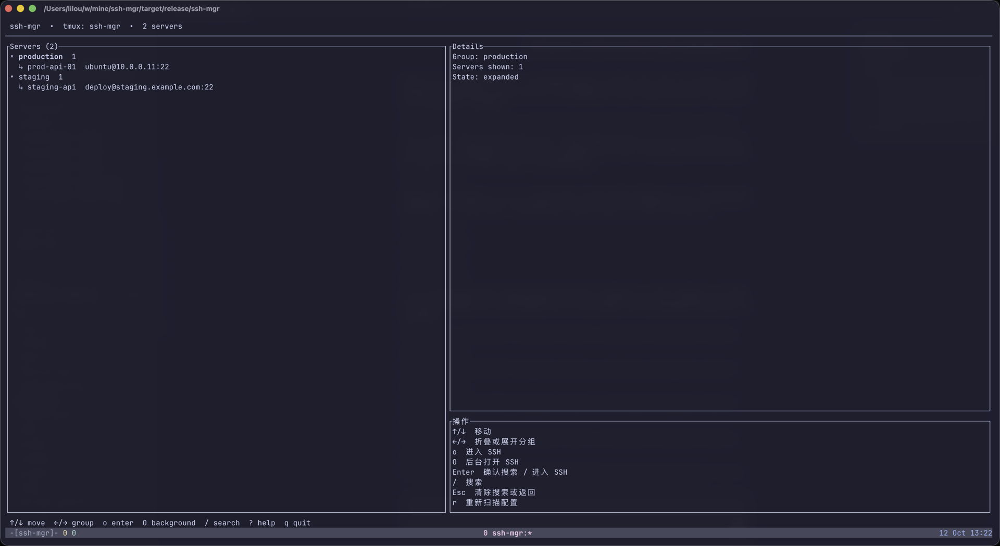
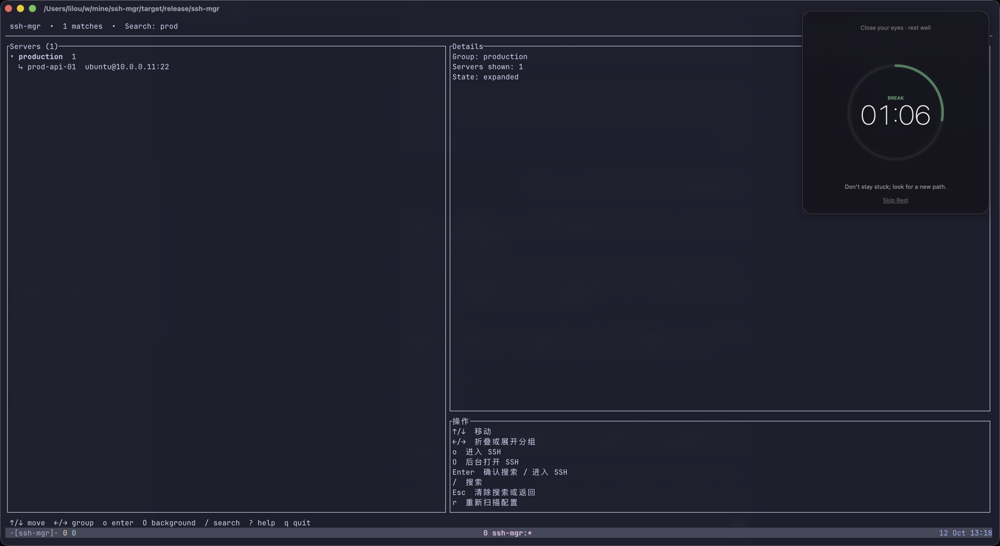
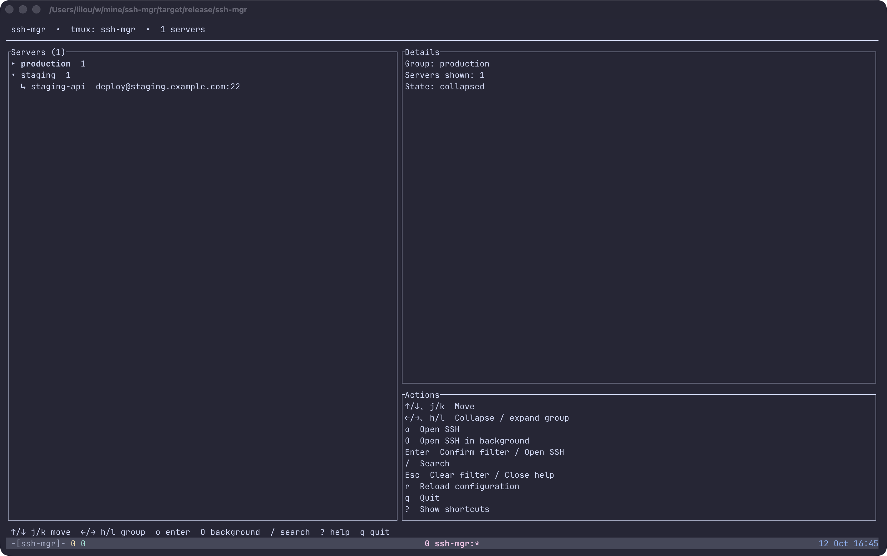
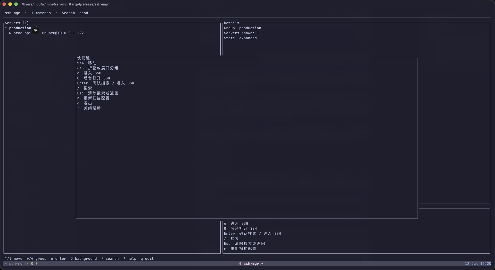

# ssh-mgr

**A keyboard driven SSH manager for tmux and terminal workflows.**

`ssh-mgr` turns a directory of small TOML files into a fast, searchable server tree. It launches the system OpenSSH client inside tmux, so interactive programs such as `vim`, `top`, and shells behave exactly as they do outside the manager.

## Why ssh-mgr

- Folder based groups that stay readable in Git.
- Fuzzy, letter by letter search across names, groups, hosts, users, descriptions, tags, and source paths.
- Native `ssh` inside tmux windows. No custom terminal emulator and no PTY translation layer.
- `o` for a foreground SSH window and `O` for a background SSH window.
- Password sources for environment variables, one time prompts, private keys, and explicit TOML values.
- Safe startup: missing default configuration is initialized with examples; existing files are never overwritten.

## Requirements

- Rust stable for building
- OpenSSH (`ssh`) on `PATH`
- tmux (`tmux`) on `PATH`

On macOS with Homebrew:

```bash
brew install tmux
```

## Install And Run

Build from source:

```bash
cargo build --release
./target/release/ssh-mgr
```

The binary automatically creates or attaches to the fixed tmux session `ssh-mgr` and runs the TUI in the `ssh-mgr` window. SSH connections become sibling windows in that session.

Useful commands:

```bash
ssh-mgr --help
ssh-mgr --version
ssh-mgr --config ./examples/config
```

The default configuration directory is `~/.config/ssh-mgr/`. It is created from the bundled examples on first launch only when it does not already exist.

## Screenshots

The screenshots below were captured from the release binary running in Ghostty with the bundled example configuration.

### Dashboard



The dashboard keeps the server tree, selected node details, action hints, and tmux context visible at the same time.

### Search



Search narrows the tree while preserving group context. Press `Enter` to confirm the filter, then use `o` or `O` on the selected server.

While typing a search, `j/k/h/l` are ordinary characters in the filter. Press `Enter` to finish typing and keep the filtered results; then `j/k` navigate and `h/l` collapse or expand groups. Press `/` to edit the filter again.

### Tree Navigation



The left and right arrow keys collapse or expand the selected group without losing the group row.

### Help



The help overlay is available with `?` and closes with `Esc`.

## Configuration

Directories are groups. A TOML file may contain one or more `[[server]]` entries:

```text
~/.config/ssh-mgr/
├── production/
│   └── api.toml
└── staging/
    └── api.toml
```

Example:

```toml
[[server]]
name = "prod-api-01"
host = "10.0.0.11"
port = 22
user = "ubuntu"
description = "Production API primary"
tags = ["production", "api"]

[server.password]
key = "~/.ssh/id_ed25519"
```

### Authentication

Use exactly one authentication source inside `[server.password]`:

```toml
# Private key. OpenSSH handles a key passphrase in the tmux window.
[server.password]
key = "~/.ssh/id_ed25519"
```

```toml
# Password from the current process environment.
[server.password]
env = "SSH_MGR_PROD_PASSWORD"
```

```toml
# OpenSSH prompts interactively in the SSH window.
[server.password]
prompt = true
```

```toml
# Supported, but plaintext. Use only for local, tightly protected files.
[server.password]
value = "example-password"
```

For `env` and `value`, ssh-mgr writes a short lived, mode `0700` askpass helper in the system temporary directory. The password is not placed in the SSH command line, tmux window name, or application logs. The helper directory is removed when the SSH process exits.

## Keyboard Controls

The interface is organized as a compact workspace: the top bar shows the active search and tmux context, the left pane is the grouped server tree, the right pane contains details and actions, and the bottom bar reports the latest operation.

| Key | Action |
| --- | --- |
| `↑` / `↓`, `j` / `k` | Move through groups and servers |
| `←`, `h` | Collapse the selected group |
| `→`, `l` | Expand the selected group |
| `o` | Enter SSH in a new tmux window |
| `O` | Open SSH in the background and keep the TUI active |
| `Enter` | Confirm search, or alias for `o` in the list |
| `/` | Start fuzzy search |
| `Esc` | Clear search or close help |
| `r` | Rescan the configuration directory |
| `?` | Show the help overlay |
| `q` | Quit |

tmux itself remains available for switching sessions and windows:

```text
Ctrl-b n       next window
Ctrl-b p       previous window
Ctrl-b w       window picker
```

## Design And Safety Notes

- ssh-mgr delegates terminal behavior to the system OpenSSH client and tmux.
- It does not write to `~/.ssh/config` or alter private keys.
- Configuration files are read recursively and never modified by `r`.
- A malformed file stops the scan with its source path and server name in the error.
- The `value` mode is intentionally explicit because plaintext credentials can leak through file backups, permissions, or source control.

## Development

```bash
cargo fmt --all -- --check
cargo test --all-targets
cargo clippy --all-targets --all-features -- -D warnings
cargo build --release
```

CI runs the same formatting, test, lint, and release build checks on every push and pull request.

## Contributing

Small, focused pull requests are welcome. Please include a regression test for parser, search, or state behavior changes. Do not commit real hosts, credentials, private keys, or generated `target/` files.

See [CONTRIBUTING.md](CONTRIBUTING.md) for the local check suite and [SECURITY.md](SECURITY.md) for credential handling and vulnerability reports. Release history is tracked in [CHANGELOG.md](CHANGELOG.md).

## License

MIT. See [LICENSE](LICENSE).
